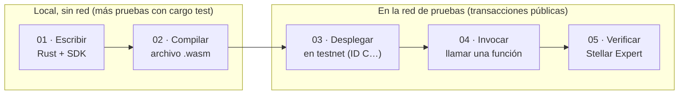

# Contratos inteligentes: de la máquina expendedora de Szabo a Soroban en la red Stellar

**Alex Hernández**  
Estudiante de Ingeniería, Universidad de La Frontera (UFRO), Temuco, Chile  
Stellar Academy · Stellar Chile  
Noviembre de 2026  
Material de apoyo de Stellar Academy

*Stellar Academy · Artículo de revisión y guía metodológica · Preprint · noviembre de 2026*

---

## Contenido

- [Resumen](#resumen)
- [Abstract](#abstract)
- [1. Introducción](#1-introducción)
- [2. Marco teórico](#2-marco-teórico)
  - [2.1 Origen del concepto: Szabo y la máquina expendedora](#21-origen-del-concepto-szabo-y-la-máquina-expendedora)
  - [2.2 De la idea a los contratos de propósito general](#22-de-la-idea-a-los-contratos-de-propósito-general)
  - [2.3 Fundamentos de blockchain y consenso](#23-fundamentos-de-blockchain-y-consenso)
- [3. Contratos inteligentes en Stellar: Soroban](#3-contratos-inteligentes-en-stellar-soroban)
  - [3.1 Rust, WebAssembly y el entorno anfitrión](#31-rust-webassembly-y-el-entorno-anfitrión)
  - [3.2 Almacenamiento, tiempo de vida y tarifas](#32-almacenamiento-tiempo-de-vida-y-tarifas)
  - [3.3 Ciclo de vida: escribir, compilar, desplegar, invocar](#33-ciclo-de-vida-escribir-compilar-desplegar-invocar)
  - [3.4 La testnet como espacio de aprendizaje](#34-la-testnet-como-espacio-de-aprendizaje)
- [4. Seguridad: cuando el código es la ley](#4-seguridad-cuando-el-código-es-la-ley)
- [5. Metodología práctica](#5-metodología-práctica)
- [6. Discusión](#6-discusión)
- [7. Conclusiones](#7-conclusiones)
- [Referencias](#referencias)

## Resumen

Este artículo revisa la evolución del concepto de contrato inteligente, desde su formulación por Nick Szabo en 1997 hasta su implementación en Soroban, la plataforma de contratos inteligentes de la red Stellar. Primero se presentan los fundamentos teóricos: la analogía de la máquina expendedora, el protocolo de gravamen inteligente, la generalización propuesta por Ethereum y el papel del consenso, con énfasis en el Stellar Consensus Protocol. Luego se describe la arquitectura de Soroban según su documentación oficial: contratos escritos en Rust y compilados a WebAssembly, tipos de almacenamiento con tiempo de vida, un modelo de tarifas basado en recursos y un ciclo de vida que va de la escritura a la invocación. Se sintetizan además las principales lecciones de seguridad documentadas en la literatura, entre ellas el caso de The DAO. Por último, se propone una metodología práctica para que estudiantes sin experiencia en programación, apoyados por herramientas de inteligencia artificial, desplieguen un contrato propio en la red de pruebas de Stellar. Se concluye que la barrera técnica de entrada ha bajado de forma notable, pero que comprender el modelo de ejecución y sus riesgos sigue siendo indispensable.

**Palabras clave:** contratos inteligentes, blockchain, Stellar, Soroban, WebAssembly, seguridad de software, educación en ingeniería.

## Abstract

This article reviews the evolution of the smart contract concept, from Nick Szabo’s 1997 formulation to its implementation in Soroban, the smart contract platform of the Stellar network. It first presents the theoretical foundations: the vending machine analogy, the smart lien protocol, the generalization proposed by Ethereum, and the role of consensus, with emphasis on the Stellar Consensus Protocol. It then describes Soroban’s architecture as documented officially: contracts written in Rust and compiled to WebAssembly, storage types with a time to live, a resource-based fee model, and a life cycle that runs from writing to invocation. The main security lessons reported in the literature, including The DAO incident, are also summarized. Finally, it proposes a hands-on methodology that allows students with no programming background, supported by artificial intelligence tools, to deploy their own contract to the Stellar test network. The article concludes that the technical barrier to entry has dropped considerably, but understanding the execution model and its risks remains essential.

**Keywords:** smart contracts, blockchain, Stellar, Soroban, WebAssembly, software security, engineering education.

## 1. Introducción

Buena parte de los acuerdos que hacemos a diario dependen de un tercero que los haga cumplir: un banco que libera un pago, un notario que da fe de una firma o un tribunal que resuelve un incumplimiento. La idea de que un programa pueda asumir parte de ese rol, ejecutando las condiciones de un acuerdo sin que nadie intervenga, es más antigua que las criptomonedas, y solo en la última década encontró la infraestructura técnica para volverse práctica.

Esa infraestructura es la blockchain, un registro compartido y replicado entre muchos participantes que acuerdan su contenido mediante un protocolo de consenso (Narayanan et al., 2016). Cuando una blockchain permite guardar y ejecutar programas, esos programas reciben el nombre de contratos inteligentes. Hoy existen varias plataformas que los soportan. Este trabajo se centra en Soroban, la plataforma de contratos inteligentes de la red Stellar, donde los contratos son programas pequeños escritos en Rust y compilados a WebAssembly (Stellar Development Foundation [SDF], s.f.-f).

El artículo nace de una necesidad docente concreta. Stellar Academy es un programa de formación de la comunidad Stellar Chile dirigido a estudiantes universitarios principiantes, en su mayoría de ingeniería, que trabajan con asistencia de inteligencia artificial, una práctica conocida informalmente como *vibecoding*. Este material tiene un objetivo doble: que cada participante entienda qué es un contrato inteligente y que logre tener uno propio desplegado en la red de pruebas de Stellar, alojado en su propio repositorio.

Con ese propósito, el texto tiene tres objetivos: (a) ordenar los conceptos esenciales a partir de las fuentes primarias; (b) describir con precisión el modelo de Soroban, basándose estrictamente en su documentación oficial; y (c) proponer una metodología de trabajo reproducible de aprendizaje. La sección 2 desarrolla el marco teórico; la sección 3 describe Soroban; la sección 4 aborda la seguridad; la sección 5 presenta la metodología práctica; la sección 6 discute los límites del enfoque, y la sección 7 resume las conclusiones.

## 2. Marco teórico

Para entender qué hace un contrato en Soroban conviene mirar primero de dónde viene la idea. Esta sección recorre tres momentos: la formulación original de Szabo, la propuesta de Ethereum de una blockchain programable de propósito general y los mecanismos de consenso que hacen confiable la ejecución.

### 2.1 Origen del concepto: Szabo y la máquina expendedora

El término se asocia al artículo que Nick Szabo publicó en 1997 en la revista *First Monday*, donde define los contratos inteligentes como la combinación de protocolos con interfaces de usuario para formalizar y asegurar relaciones a través de redes de computadores (Szabo, 1997). Szabo no escribía sobre blockchains, que aún no existían, sino sobre cómo la criptografía y los protocolos seguros podían incorporar las cláusulas de un acuerdo directamente en los sistemas que controlan un bien.

> «La idea básica detrás de los contratos inteligentes es que muchos tipos de cláusulas contractuales (como garantías, fianzas, delimitación de derechos de propiedad, etc.) pueden incorporarse en el hardware y el software con los que tratamos, de tal manera que el incumplimiento del contrato resulte costoso (si se desea, a veces prohibitivamente) para quien lo incumple».
>
> *Original:* The basic idea behind smart contracts is that many kinds of contractual clauses (such as collateral, bonding, delineation of property rights, etc.) can be embedded in the hardware and software we deal with, in such a way as to make breach of contract expensive (if desired, sometimes prohibitively so) for the breacher.
>
> — Szabo (1997), sección «Contracts Embedded in the World»

Para ilustrar la idea, Szabo recurre a un objeto cotidiano. Una máquina expendedora recibe monedas y, mediante un mecanismo simple, entrega el producto y el vuelto según el precio indicado. Szabo observa que diseñarla es un problema de autómatas finitos propio de un primer curso de computación, y que cualquiera que tenga monedas puede participar del intercambio, sin conocer al vendedor (Szabo, 1997). La máquina no necesita confiar en el cliente ni el cliente en un empleado: las reglas están en el mecanismo, y la caja fuerte protege lo acumulado frente a quien intente romperla.

> «Un ejemplo canónico de la vida real, que podríamos considerar el ancestro primitivo de los contratos inteligentes, es la humilde máquina expendedora».
>
> *Original:* A canonical real-life example, which we might consider to be the primitive ancestor of smart contracts, is the humble vending machine.
>
> — Szabo (1997), sección «Contracts Embedded in the World»

El segundo ejemplo de Szabo es más ambicioso y anticipa los usos financieros actuales. Imagina un automóvil con un sistema digital de llaves criptográficas comprado con un crédito. Si el dueño deja de pagar, un *protocolo de gravamen inteligente* (*smart lien protocol*) devuelve el control de las llaves al banco; cuando el préstamo se termina de pagar, una versión más refinada eliminaría el gravamen de forma verificable. Szabo agrega una salvedad que sigue vigente: el protocolo debe contemplar excepciones operativas, porque sería inaceptable revocar el uso del auto mientras circula por la carretera (Szabo, 1997). Ese detalle muestra que, ya en su origen, el concepto reconocía que automatizar un acuerdo obliga a pensar los casos límite.

### 2.2 De la idea a los contratos de propósito general

Bitcoin, lanzado en 2009, ya incluía un lenguaje de *scripts* para fijar condiciones sobre las transacciones, pero era deliberadamente limitado. El libro blanco de Ethereum señala, entre otras limitaciones, que ese lenguaje no es Turing-completo, porque carece de ciclos para evitar ejecuciones infinitas durante la verificación de transacciones (Buterin, 2014). La propuesta de Ethereum fue construir una blockchain con un lenguaje de programación completo, en la que los contratos pudieran codificar funciones de transición de estado arbitrarias.

> «Los contratos inteligentes, “cajas” criptográficas que contienen valor y solo lo liberan si se cumplen ciertas condiciones, también pueden construirse sobre la plataforma».
>
> *Original:* Smart contracts, cryptographic "boxes" that contain value and only unlock it if certain conditions are met, can also be built on top of the platform
>
> — Buterin (2014), sección «Ethereum»

El mismo documento precisa que estos «contratos» no deben entenderse como algo que se «cumple» en sentido jurídico, sino como agentes autónomos que viven dentro del entorno de ejecución, que ejecutan siempre el mismo código al recibir un mensaje o una transacción y que controlan su propio saldo y su propio almacenamiento (Buterin, 2014). Antonopoulos et al. (2025) llevan esa precisión más lejos y advierten que el término es casi un nombre equivocado, ya que estos programas no son ni inteligentes ni contratos legales. En su definición, un contrato inteligente es un programa de computador *inmutable*, porque una vez desplegado su código no cambia, y *determinista*, porque produce el mismo resultado para todos quienes lo ejecutan con el mismo estado de entrada.

De esta tradición provienen tres propiedades que se repiten en todas las plataformas y que conviene retener. Primero, un contrato solo se ejecuta cuando una transacción lo llama: nunca corre «solo» ni en segundo plano. Segundo, las transacciones son atómicas, de modo que si la ejecución falla, todos sus cambios se revierten como si nunca hubiera ocurrido. Tercero, la ejecución tiene un costo que paga quien envía la transacción (Antonopoulos et al., 2025). Como se verá en la sección 3, Soroban conserva estas tres ideas, aunque con decisiones de diseño propias.

### 2.3 Fundamentos de blockchain y consenso

Un contrato inteligente es confiable solo si el registro donde vive también lo es. Narayanan et al. (2016) explican que el problema central de una moneda digital descentralizada es lograr que nodos que no se conocen ni confían entre sí acuerden un único historial de transacciones. Bitcoin lo resuelve con prueba de trabajo, donde los participantes compiten resolviendo acertijos computacionales, a cambio de un alto consumo de energía.

Stellar sigue otro camino. Mazières (2016) propone un modelo llamado *acuerdo bizantino federado* (FBA, por sus siglas en inglés), en el que cada nodo decide individualmente en qué otros nodos confía. Esas decisiones, denominadas *quorum slices*, se combinan y determinan los quórums de todo el sistema, de manera parecida a como los acuerdos de interconexión entre redes individuales unifican hoy internet. Sobre ese modelo se construye el Stellar Consensus Protocol (SCP), que, a diferencia de los protocolos bizantinos clásicos, no exige una lista de miembros aceptada por todos y admite membresía abierta. Según el autor, comparado con la prueba de trabajo y la prueba de participación, el SCP tiene requisitos computacionales y financieros modestos, lo que reduce la barrera de entrada.

> «Necesitamos una red financiera mundial abierta a cualquiera, para que nuevas organizaciones puedan unirse y extender el acceso financiero a comunidades sin servicio».
>
> *Original:* We need a worldwide financial network open to anyone, so that new organizations can join and extend financial access to unserved communities.
>
> — Mazières (2016), sección 1, «Introduction»

Para efectos prácticos, la consecuencia práctica es simple: cuando un estudiante despliega o invoca un contrato, su transacción será validada por una red de nodos que llega a acuerdo mediante el SCP, sin minería, y el resultado quedará registrado de forma pública y verificable.

## 3. Contratos inteligentes en Stellar: Soroban

Con el marco conceptual definido, esta sección describe cómo funcionan los contratos en Stellar. Toda la información proviene de la documentación oficial de la Stellar Development Foundation, consultada en noviembre de 2026 (SDF, s.f.-h); dado que la plataforma evoluciona con rapidez, se recomienda contrastar los detalles con la versión vigente de la documentación.

Lo primero es aclarar qué no es Soroban. La documentación es explícita: Soroban no es una nueva blockchain, sino una plataforma de contratos inteligentes integrada en la blockchain de Stellar ya existente, que convive con las operaciones tradicionales de la red sin reemplazarlas (SDF, s.f.-f). Los contratos se invocan enviando una transacción que contiene la operación `InvokeHostFunctionOp`, comparten las cuentas de Stellar para autenticarse y pueden interactuar con los activos de Stellar mediante el Stellar Asset Contract, que viene incorporado.

### 3.1 Rust, WebAssembly y el entorno anfitrión

Los contratos de Soroban se escriben en Rust y se compilan a WebAssembly (Wasm) para su despliegue; por ahora, Rust es el único lenguaje soportado (SDF, s.f.-f). Pero no se usa el Rust completo: por los límites de recursos y las consideraciones de seguridad, los contratos trabajan con un subconjunto acotado del lenguaje. La biblioteca estándar de Rust y la mayoría de las bibliotecas de terceros (*crates*) no están disponibles directamente, y su lugar lo ocupa el Soroban Rust SDK, que entrega estructuras de datos y acceso a funciones propias del entorno, como hashing criptográfico, verificación de firmas, almacenamiento persistente e invocación de otros contratos.

El código del contrato corre dentro de un *entorno anfitrión* (*host environment*), un conjunto de componentes que incluye las funciones del anfitrión, la interfaz con el almacenamiento en la cadena, el sistema de contabilidad de recursos y cobro de tarifas, y un intérprete de Wasm (SDF, s.f.-f). Un punto pedagógicamente valioso es que la herramienta de línea de comandos incluye una implementación de ese entorno idéntica a la que corre en la red, de modo que un contrato puede probarse en el computador del estudiante antes de publicarse.

El contrato de ejemplo con el que parte la guía oficial ilustra la estructura mínima. El atributo `#[contract]` marca el tipo al que se asocian las funciones del contrato, y `#[contractimpl]` marca el bloque donde se definen; las funciones que se invocarán desde fuera deben ser públicas (`pub`), y es habitual que reciban como primer argumento el entorno `Env` (SDF, s.f.-d):

```rust
#![no_std]
use soroban_sdk::{contract, contractimpl, vec, Env, String, Vec};

#[contract]
pub struct Contract;

#[contractimpl]
impl Contract {
    pub fn hello(env: Env, to: String) -> Vec<String> {
        vec![&env, String::from_str(&env, "Hello"), to]
    }
}
```

La función `hello` recibe un texto y devuelve una lista con el saludo y ese texto. Es un contrato trivial, pero contiene todo lo necesario para recorrer el ciclo completo de desarrollo, y por eso es el punto de partida de esta guía.

### 3.2 Almacenamiento, tiempo de vida y tarifas

Un contrato que solo calcula es poco útil; casi siempre necesita recordar algo, como un contador, un saldo o una lista de votos. En Soroban, los datos de un contrato se guardan como entradas del libro mayor de tipo `CONTRACT_DATA`, identificadas por el contrato que las posee, el tipo de almacenamiento y una clave elegida por el programador. Un contrato solo puede leer y escribir sus propias entradas: intentar acceder a las de otro contrato hace fallar la transacción (SDF, s.f.-g).

Existen tres tipos de almacenamiento —`Persistent`, `Temporary` e `Instance`— con la misma interfaz, que se diferencian en sus tarifas y en su comportamiento de archivo. Todos los datos tienen un *tiempo de vida* (TTL, *time to live*) que debe extenderse periódicamente (SDF, s.f.-i). La Tabla 1 resume sus diferencias.

| Tipo | Cuando el TTL llega a cero | Uso típico |
|---|---|---|
| `Temporary` | Se elimina de forma permanente y no puede recuperarse. | Datos acotados en el tiempo o fáciles de recrear, como precios de oráculos o firmas. Es el más barato. |
| `Persistent` | Se archiva y debe restaurarse antes de usarse. Tiene su propio TTL, independiente del contrato. | Datos de usuario que no pueden ser temporales, como saldos. |
| `Instance` | Se archiva igual que `Persistent`, pero comparte el TTL de la instancia del contrato. | Estado compartido del contrato, como cuentas de administrador o metadatos. Capacidad limitada. |

**Tabla 1.** Tipos de almacenamiento en Soroban. Elaboración propia a partir de SDF (s.f.-i).

Este modelo de «renta» del almacenamiento es una diferencia importante con otras plataformas y conviene explicarlo con calma: guardar datos en una red pública tiene un costo continuo, y un dato que nadie mantiene vivo termina archivado o borrado.

En cuanto a las tarifas, toda transacción que ejecuta un contrato paga dos componentes: una *tarifa de recursos*, calculada según el consumo declarado de recursos como cómputo y acceso al almacenamiento, y una *tarifa de inclusión*, que es lo máximo que el remitente está dispuesto a pagar para que su transacción entre al libro mayor (SDF, s.f.-c). Si la transacción intenta superar los recursos declarados, falla. La forma recomendada de estimar esos valores es simular la transacción antes de enviarla, algo que la herramienta de línea de comandos hace de forma automática.

### 3.3 Ciclo de vida: escribir, compilar, desplegar, invocar

La documentación describe el ciclo de vida de un contrato en etapas de desarrollo, despliegue, ejecución y monitoreo (SDF, s.f.-a). Para fines docentes, lo reducimos a cinco pasos, representados en la Figura 1.



**Figura 1.** Ciclo de vida simplificado de un contrato en Soroban. Elaboración propia a partir de SDF (s.f.-a, s.f.-b, s.f.-d).

**Escribir y probar en local.** El desarrollo puede hacerse en un computador personal con tres componentes: un editor, la cadena de herramientas de Rust y el SDK de Soroban. Como el SDK contiene una copia funcional del entorno anfitrión y una versión simulada del libro mayor, es posible —y se recomienda— editar, compilar, probar y depurar el contrato completamente fuera de línea (SDF, s.f.-a).

**Compilar.** Para desplegarlo, el contrato debe compilarse a Wasm. El comando `stellar contract build` configura el compilador de Rust con los parámetros correctos, optimiza el archivo resultante y procesa la especificación del contrato; la documentación recomienda usar siempre este comando en lugar de invocar `cargo build` directamente (SDF, s.f.-d).

**Desplegar.** El archivo Wasm se incluye en una transacción enviada a la red de destino. Desplegar requiere credenciales para firmar la transacción y pagar sus tarifas, y la documentación indica que los contratos deben desplegarse y probarse a fondo en redes de prueba antes de llegar a la red principal (SDF, s.f.-a). El resultado es un identificador de contrato que comienza con la letra C (SDF, s.f.-b).

**Invocar.** Una vez en la red, el contrato vive en una entrada del libro mayor y se ejecuta dentro de una máquina virtual aislada (*sandbox*). Cada ejecución termina con éxito o con un error (*trap*). Si termina con éxito, todos los cambios se escriben de forma atómica; si falla, se descartan y el contrato no tiene efecto alguno (SDF, s.f.-a). Es la misma atomicidad descrita en la sección 2.2.

**Verificar.** Las transacciones y los contratos pueden inspeccionarse en exploradores públicos como Stellar Expert. La documentación menciona además un proceso de validación con GitHub Actions que vincula el contrato desplegado con el *commit* exacto de su código fuente, de modo que cualquiera puede confirmar que el código publicado corresponde al desplegado (SDF, s.f.-a).

Una diferencia relevante frente a la definición «inmutable» de la sección 2.2 es que Soroban documenta un mecanismo para actualizar el código Wasm de un contrato ya desplegado sin cambiar su dirección, siempre que el propio contrato lo implemente (SDF, s.f.-a). La inmutabilidad, entonces, depende de cómo se diseña el contrato y no es una propiedad absoluta de toda plataforma.

### 3.4 La testnet como espacio de aprendizaje

Stellar tiene tres redes: la principal (Mainnet), la de pruebas (Testnet) y una red de desarrollo (Futurenet). La testnet funciona como la red principal, pero no está conectada a dinero real; sus cuentas se financian gratis con Friendbot, un servicio que entrega XLM de prueba, y se reinicia periódicamente, borrando cuentas, datos de contratos e historial (SDF, s.f.-e). Para quienes comienzan, esto es una ventaja: equivocarse no cuesta nada. Al mismo tiempo, impone una advertencia práctica: lo que se despliegue hoy puede desaparecer en el próximo reinicio, así que el registro duradero del trabajo debe ser el repositorio del estudiante, no la red.

## 4. Seguridad: cuando el código es la ley

Las mismas propiedades que hacen atractivos a los contratos inteligentes —ejecución automática, código público y resultados difíciles de revertir— los convierten en un blanco atractivo. Antes de desplegar, aunque sea en una red de pruebas, conviene entender por qué la seguridad no es un tema avanzado, sino una condición de partida.

> «Como ocurre con otros programas, un contrato inteligente ejecutará exactamente lo que está escrito, que no siempre es lo que el programador pretendía».
>
> *Original:* As with other programs, a smart contract will execute exactly what is written, which is not always what the programmer intended.
>
> — Antonopoulos et al. (2025), cap. 9, «Smart Contract Security»

Los autores agregan que todos los contratos son públicos, que cualquiera puede interactuar con ellos con solo crear una transacción y que las pérdidas son casi siempre imposibles de recuperar (Antonopoulos et al., 2025). Por eso proponen la *programación defensiva*: diseños mínimos y simples, reutilización de código probado, calidad comparable a la de disciplinas como la ingeniería aeroespacial, código legible y auditable, y pruebas exhaustivas que nunca supongan que las entradas son correctas o benignas.

La evidencia empírica respalda esta advertencia. Luu et al. (2016) estudiaron la seguridad de los contratos de Ethereum y mostraron que un adversario puede manipular su ejecución para obtener ganancias, lo que revela brechas sutiles en la comprensión de la semántica distribuida de la plataforma. Para detectar estos errores construyeron Oyente, una herramienta de ejecución simbólica que, aplicada a 19.336 contratos existentes, marcó 8.833 como vulnerables, incluido el error de The DAO, que llevó a una pérdida de 60 millones de dólares en junio de 2016. Atzei et al. (2017), por su parte, analizaron las vulnerabilidades de los contratos de Ethereum, propusieron una taxonomía de errores de programación comunes que pueden conducir a ellas y mostraron una serie de ataques que permiten a un adversario robar dinero o causar otros daños.

The DAO es el caso de estudio obligado. Según Antonopoulos et al. (2025), el ataque de 2016 explotó una vulnerabilidad de *reentrada* (*reentrancy*): el atacante logra volver a llamar al contrato antes de que este termine de actualizar su estado, y aprovecha esa inconsistencia momentánea para, por ejemplo, retirar fondos repetidamente. El contrato contenía en ese momento más de 150 millones de dólares, y para revertir los efectos la comunidad de Ethereum optó por una bifurcación dura (*hard fork*) que dividió la cadena: Ethereum Classic continuó como la cadena original y la versión bifurcada pasó a ser el Ethereum actual. Las cifras de Luu et al. (2016) y de Antonopoulos et al. (2025) no son contradictorias: la primera se refiere a la pérdida y la segunda al total que mantenía el contrato.

Estas fuentes analizan Ethereum y su lenguaje Solidity, por lo que sus ataques no se trasladan uno a uno a Soroban, que tiene otro modelo de ejecución y de almacenamiento. Las lecciones de fondo, en cambio, sí son generales: el código hace lo que dice y no lo que quisimos decir, las entradas pueden ser maliciosas, la complejidad agranda la superficie de ataque y los errores en producción son caros. La categoría de seguridad de Stellar Academy profundiza en estos temas; como punto de partida basta con una regla operativa: trabajar solo en la testnet y nunca compartir una llave privada.

## 5. Metodología práctica

Esta sección traduce lo anterior en un procedimiento que un estudiante sin experiencia previa puede seguir en alrededor de una hora, apoyado por un asistente de inteligencia artificial. Los comandos provienen de la guía oficial de primeros pasos (SDF, s.f.-b, s.f.-d) y deben contrastarse con su versión vigente, porque las herramientas se actualizan con frecuencia.

> [!IMPORTANT]
> **Reglas de práctica.** Se trabaja exclusivamente en la **testnet**, con XLM de prueba sin valor. La llave secreta de la identidad la guarda la herramienta en el computador del estudiante: **nunca** se pega en un chat, en un asistente de IA, en Discord ni en el repositorio. Nadie del equipo de Stellar Academy la pedirá jamás.

1. **Preparar el entorno.** Instalar Rust (versión 1.84 o superior) con `rustup`, agregar el objetivo de compilación con `rustup target add wasm32v1-none` e instalar la herramienta de línea de comandos de Stellar, por ejemplo con `cargo install --locked stellar-cli` o `brew install stellar-cli` (SDF, s.f.-d). Conviene hacerlo antes de comenzar, para no ocupar el tiempo de práctica en instalaciones.

2. **Crear una identidad de prueba.** Generar y financiar una cuenta en la testnet:

   ```bash
   stellar keys generate alumno --network testnet --fund
   stellar keys address alumno
   ```

   El segundo comando muestra la dirección pública (comienza con G), que sí puede compartirse.

3. **Crear el proyecto.** Iniciar un proyecto con el contrato de ejemplo e inicializar el repositorio:

   ```bash
   stellar contract init mi-contrato
   cd mi-contrato
   git init
   ```

   El comando crea un espacio de trabajo con el contrato `hello-world` y, en versiones recientes de la herramienta, un archivo `AGENTS.md` con instrucciones para asistentes de IA (SDF, s.f.-d).

4. **Leer el contrato con IA.** Abrir `contracts/hello-world/src/lib.rs` y pedir al asistente una explicación línea por línea. Un buen enunciado es: «Explícame este contrato de Soroban línea por línea, como a alguien que nunca ha programado. ¿Qué hace cada atributo y qué devuelve la función?». El objetivo es poder explicar con palabras propias qué hace el código antes de cambiarlo.

5. **Hacer una modificación pequeña.** Pedir un cambio acotado, por ejemplo que el saludo diga «Hola» en vez de «Hello» o agregar una segunda función simple. Después, ejecutar las pruebas con `cargo test` y, si fallan, pedir a la IA que explique el error antes de corregirlo. Un cambio pequeño y comprendido vale más que uno grande que no se entiende.

6. **Compilar.** Ejecutar `stellar contract build`. El archivo resultante queda en `target/wasm32v1-none/release/hello_world.wasm`.

7. **Desplegar en la testnet.**

   ```bash
   stellar contract deploy \
     --wasm target/wasm32v1-none/release/hello_world.wasm \
     --source-account alumno \
     --network testnet \
     --alias hello_world
   ```

   El comando devuelve el identificador del contrato, que comienza con C (SDF, s.f.-b).

8. **Invocar el contrato.**

   ```bash
   stellar contract invoke --id hello_world \
     --source-account alumno --network testnet \
     -- hello --to Temuco
   ```

   Como `hello` solo lee datos, la herramienta simula la llamada y no envía una transacción; para enviarla igualmente se agrega `--send=yes` (SDF, s.f.-d).

9. **Verificar en Stellar Expert.** Buscar el identificador del contrato en el explorador de la testnet (`https://stellar.expert/explorer/testnet`) y revisar la transacción de despliegue. Compartir ese enlace sirve como evidencia del logro.

10. **Documentar y publicar.** Hacer *commit* del código y del identificador desplegado en un `README.md`, y subir el repositorio a GitHub. Antes de hacerlo, revisar que ningún archivo contenga llaves secretas.

El diseño de la secuencia responde a una lógica de andamiaje. Los pasos 1 a 3 son mecánicos y se pueden copiar; el paso 4 obliga a comprender; el paso 5 introduce el error como parte normal del aprendizaje, y los pasos 6 a 10 dan una evidencia pública y verificable del resultado. La IA cumple el rol de tutor, no de autor: el criterio para avanzar no es que el código funcione, sino que el estudiante pueda explicar por qué funciona.

## 6. Discusión

El recorrido anterior puede dejar la impresión de que un contrato inteligente resuelve el problema de la confianza. La literatura revisada sugiere una conclusión más matizada, y conviene discutir al menos cuatro límites con los estudiantes.

**El problema del oráculo.** Un contrato solo conoce lo que está en la cadena. Antonopoulos et al. (2025) describen el contexto de ejecución de un contrato como muy limitado: puede acceder a su propio estado, a la transacción que lo llamó y a cierta información de los bloques recientes. El protocolo de gravamen de Szabo (1997) funcionaba porque el automóvil podía «saber» si se había pagado; en una blockchain, cualquier dato del mundo exterior —un precio, una entrega, una asistencia— debe ser aportado por alguien, y la confianza se traslada a esa fuente. Diseñar contratos útiles exige identificar quién aporta cada dato y qué incentivos tiene.

**Exigibilidad jurídica.** Szabo derivó sus principios de diseño, entre otras fuentes, del derecho y de la teoría económica (Szabo, 1997), pero un contrato inteligente no es por sí mismo un contrato en sentido legal: Antonopoulos et al. (2025) subrayan que, en este contexto, la palabra no tiene significado jurídico. El código puede asegurar que se ejecute una transferencia, pero no resuelve por sí solo si el acuerdo era válido, si hubo error o fraude, o qué ocurre cuando el resultado del código contradice la intención de las partes. El caso de The DAO, resuelto finalmente por una decisión social de la comunidad mediante una bifurcación de la cadena, muestra que «el código es la ley» tiene límites también en la práctica.

**Riesgos del desarrollo asistido por IA.** El *vibecoding* baja de forma notable la barrera de entrada, y es la razón por la que un estudiante sin experiencia puede desplegar un contrato en una hora. Pero agrava el riesgo que describe la cita de la sección 4: si un contrato ejecuta exactamente lo que está escrito y quien lo despliega no entiende lo que está escrito, nadie controla realmente lo que hace. Un asistente puede producir código que compila y aun así contiene errores lógicos, usar versiones obsoletas de una biblioteca o «inventar» funciones que no existen. Las prácticas defensivas de la sección 4 —simplicidad, pruebas, revisión— son todavía más necesarias cuando el autor del código es un modelo de lenguaje, y la regla de no compartir llaves privadas se extiende a los propios asistentes.

**Inmutabilidad y mantenimiento.** La definición clásica presenta los contratos como inmutables (Antonopoulos et al., 2025), mientras que Soroban permite contratos actualizables y exige mantener vivo su almacenamiento mediante TTL (SDF, s.f.-a, s.f.-i). Ninguna de las dos opciones es neutral: la inmutabilidad da garantías a los usuarios, pero impide corregir errores; la posibilidad de actualizar permite corregirlos, pero obliga a confiar en quien controla la actualización. Elegir entre ambas es una decisión de diseño con consecuencias de seguridad y de gobernanza.

Este trabajo tiene límites propios. Es una revisión narrativa, no sistemática; la descripción de Soroban se basa en documentación que cambia con frecuencia, y la metodología propuesta no ha sido evaluada formalmente con resultados de aprendizaje. Medir cuántos estudiantes logran desplegar su contrato y cuánto comprenden de él sería una extensión natural de este artículo.

## 7. Conclusiones

La idea de Szabo era sencilla: incorporar las cláusulas de un acuerdo en los sistemas que controlan un bien, de modo que incumplirlas resulte costoso. Casi tres décadas después, esa idea se ejecuta sobre blockchains públicas. Ethereum la generalizó al proponer contratos como programas de propósito general, y Stellar la integra en una red diseñada para pagos, con un consenso federado que no depende de la minería.

Soroban aporta decisiones de diseño concretas: contratos en Rust compilados a WebAssembly, un entorno de pruebas local idéntico al de la red, almacenamiento con tiempo de vida, tarifas basadas en recursos y ejecución atómica. Para la formación de principiantes, la combinación de la testnet, la herramienta de línea de comandos y los asistentes de IA hace posible que un estudiante sin experiencia recorra en una sola jornada el ciclo completo de escribir, compilar, desplegar, invocar y verificar.

La facilidad técnica, sin embargo, no reemplaza la comprensión. Las fuentes coinciden en que un contrato ejecuta exactamente lo que dice su código, que sus errores son públicos y caros, y que su relación con la realidad y con el derecho tiene límites. La propuesta metodológica de este artículo apunta, por eso, a que cada participante no solo despliegue su contrato, sino que sea capaz de explicar qué hace, por qué funciona y qué podría salir mal.

## Referencias

Antonopoulos, A. M., Wood, G., Parisi, C., Mazza, A., y Pozzolini, N. (2025). *Mastering Ethereum: Implementing smart contracts* (2.ª ed.). O’Reilly Media. Capítulo 7, <https://github.com/ethereumbook/ethereumbook/blob/develop/src/chapter_7.md>; capítulo 9, <https://github.com/ethereumbook/ethereumbook/blob/develop/src/chapter_9.md>

Atzei, N., Bartoletti, M., y Cimoli, T. (2017). A survey of attacks on Ethereum smart contracts (SoK). En *Principles of Security and Trust: POST 2017* (pp. 164–186). Springer Berlin Heidelberg. <https://doi.org/10.1007/978-3-662-54455-6_8>. Preprint: <https://eprint.iacr.org/2016/1007>

Buterin, V. (2014). *Ethereum: A next-generation smart contract and decentralized application platform* [Libro blanco]. ethereum.org. <https://ethereum.org/en/whitepaper/>

Luu, L., Chu, D.-H., Olickel, H., Saxena, P., y Hobor, A. (2016). Making smart contracts smarter. En *Proceedings of the 2016 ACM SIGSAC Conference on Computer and Communications Security* (pp. 254–269). ACM. <https://doi.org/10.1145/2976749.2978309>. Preprint: <https://eprint.iacr.org/2016/633>

Mazières, D. (2016). *The Stellar Consensus Protocol: A federated model for Internet-level consensus* [Borrador del 25 de febrero de 2016]. Stellar Development Foundation. <https://www.stellar.org/papers/stellar-consensus-protocol>

Narayanan, A., Bonneau, J., Felten, E., Miller, A., y Goldfeder, S. (2016). *Bitcoin and cryptocurrency technologies: A comprehensive introduction*. Princeton University Press. <https://bitcoinbook.cs.princeton.edu/>

Stellar Development Foundation. (s.f.-a). *Contract lifecycle*. Stellar Docs. Recuperado el 12 de noviembre de 2026, de <https://developers.stellar.org/docs/learn/fundamentals/contract-development/contract-lifecycle>

Stellar Development Foundation. (s.f.-b). *Deploy to Testnet*. Stellar Docs. Recuperado el 12 de noviembre de 2026, de <https://developers.stellar.org/docs/build/smart-contracts/getting-started/deploy-to-testnet>

Stellar Development Foundation. (s.f.-c). *Fees, resource limits, and metering*. Stellar Docs. Recuperado el 12 de noviembre de 2026, de <https://developers.stellar.org/docs/learn/fundamentals/fees-resource-limits-metering>

Stellar Development Foundation. (s.f.-d). *Hello World*; *Setup*; *Build and deploy a contract*. Stellar Docs. Recuperado el 12 de noviembre de 2026, de <https://developers.stellar.org/docs/build/smart-contracts/getting-started/hello-world>, <https://developers.stellar.org/docs/build/smart-contracts/getting-started/setup> y <https://developers.stellar.org/docs/tools/cli/agent-cli/guides/build-and-deploy-contracts>

Stellar Development Foundation. (s.f.-e). *Networks*. Stellar Docs. Recuperado el 12 de noviembre de 2026, de <https://developers.stellar.org/docs/networks>

Stellar Development Foundation. (s.f.-f). *Overview* [Smart contracts]. Stellar Docs. Recuperado el 12 de noviembre de 2026, de <https://developers.stellar.org/docs/build/smart-contracts/overview>

Stellar Development Foundation. (s.f.-g). *Persisting data*. Stellar Docs. Recuperado el 12 de noviembre de 2026, de <https://developers.stellar.org/docs/learn/fundamentals/contract-development/storage/persisting-data>

Stellar Development Foundation. (s.f.-h). *Smart contracts* [Contract development]. Stellar Docs. Recuperado el 12 de noviembre de 2026, de <https://developers.stellar.org/docs/learn/fundamentals/contract-development>

Stellar Development Foundation. (s.f.-i). *State archival*. Stellar Docs. Recuperado el 12 de noviembre de 2026, de <https://developers.stellar.org/docs/learn/fundamentals/contract-development/storage/state-archival>

Szabo, N. (1997). Formalizing and securing relationships on public networks. *First Monday, 2*(9). <https://doi.org/10.5210/fm.v2i9.548>

---

### Sobre el autor

Alex Hernández es estudiante de Ingeniería en la Universidad de La Frontera (Temuco, Chile) y participa en Stellar Academy, el programa de formación de la comunidad Stellar Chile.

### Cómo citar este artículo (APA 7)

Hernández, A. (2026). *Contratos inteligentes: De la máquina expendedora de Szabo a Soroban en la red Stellar* [Preprint]. Stellar Academy, Universidad de La Frontera.

Nota: las citas textuales en inglés se acompañan de una traducción al español del autor. Los comandos de la sección 5 corresponden a la documentación oficial vigente en noviembre de 2026.

© 2026 Alex Hernández · Stellar Academy · Stellar Chile · Temuco
